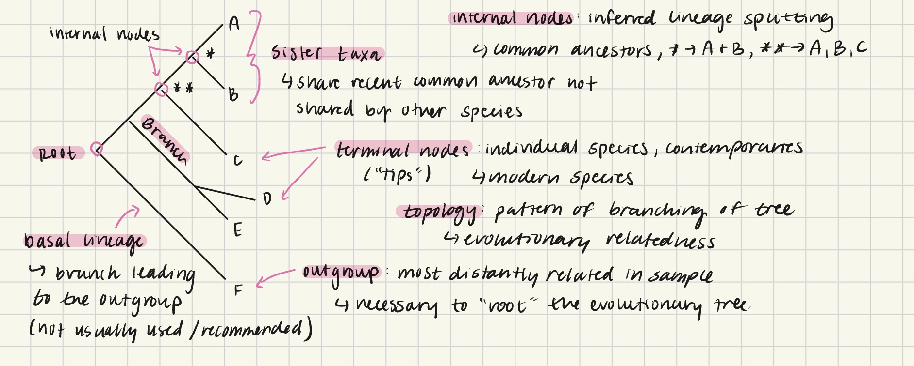

Very rough draft of this section:

Basic phylogenetics definition: the scientific study of the evolutionary history and relationships among individuals, groups of organisms (taxa), or genes (wikipedia). In this case we are focused on the genes of pathogens

an introduction to phylogenetic trees. Explains how trees are built and what each part of the tree means. Terms like root, internal nodes, terminal nodes (“tips”), branches, outgroup, etc. will be defined. Below is an example of explanations from my own notes.

{width=50%}

Also to be explained:

Epidemiological Interpretation of Trees: branching patterns, length of branches, how trees reflect things like transmission dynamics and growth rate. Pathogen mutations. Importance of the topic