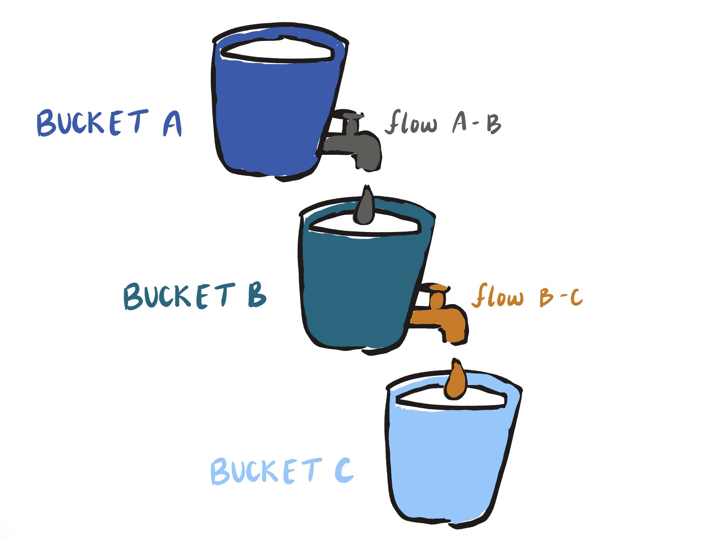

## SIR Models

The primary question we are asking here is this: How does a disease spread in the population? We can translate this process into a mathematical model.

The main type of model we will focus on is called an *SIR* model: Susceptible, Infected, Recovered. These are the three compartments, that an individual in the population can be in with regards to a specific disease. There are other more complicated kinds of models as well such as SIRS (meaning you become susceptible to the disease again after some time), SEIR (additional compartment for exposed), and more. Models can become more complex depending on the specific process of some disease. Likewise, the mathematical models can become more complex.

Each compartmental model for a disease has some specific mathematical equation behind each movement of individuals in the population across the compartments. These equations are called ordinary differential equations (ODEs), which will be explained in this tutorial.

We can think about the three compartments of the SIR model as buckets. 

{width=50%}

Difference equations

$$
\textcolor{#2042c7}{\text{Bucket A }(t+1)} =\textcolor{#2042c7}{\text{Bucket A }(t)} \textcolor{gray}{- \text{flow } A-B}\\
\textcolor{#4395a3}{\text{Bucket B }(t+1)} = \textcolor{#4395a3}{\text{Bucket B }(t)} \textcolor{gray}{+ \text{flow } A-B} \textcolor{#db8309}{-\text{flow }B - C}\\
\textcolor{#8cc9f5}{\text{Bucket C } (t+1)} = \textcolor{#8cc9f5}{\text{Bucket C }(t)} \textcolor{#db8309}{+\text{flow }B - C}
$$

Next steps:

- adding in and explaining the ODEs that are a part of the SIR model. They explain how the population moves through the compartments of the SIR model based on the dynamics of the disease
- Conclusion of importance to understanding these models

Source: Presentation by Dr.Kirstin Oliveira Roster, adapted from Dr.Stephen Kissler

